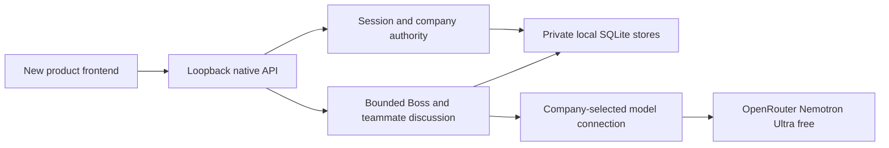

# Architecture and extraction boundaries

## Running local product

The default installer builds `product/` and runs `product-backend/local_server.py`. It does not serve the legacy frontend. The new frontend uses retained native authentication, company authority, profiles and messaging libraries from `dashboard/backend`; their location does not select the old UI.

Team discussions require an authenticated human source message, an admitted Boss and selected teammates, current room grants and configured per-bot connections. Requests, replies and the final synthesis persist as attributed native messages. The journal records provider response IDs, bounded model attempts and stop states. Fixture tests do not establish actual provider acceptance. Generated-app workers, their trusted previews and autonomous execution tools are not configured by this local composition.

See [the runtime contract](../product-backend/runtime-contract.json), [current API coverage](new-product-api-coverage.md) and [source provenance](new-product-source.md). The candidate inspection below records upstream evidence separately from this local implementation.

## Corrected product target and bootstrap mapping

### Pinned product candidates

The authoritative read-only source lead is /srv/starlidigital/mcp-workspace/server/src/grokbot-gemini-autonomous-company-wave1-20261120/codex. At inspection, coordinator-r1/CURRENT-VERIFIED-STATE.json latestPrivateDemo referenced assembly-r1/next-v9/JOINED-RELEASE-PINS.json. Its recorded browser evidence covers cosmic input, an explicit guest send into an actual temporary workspace, actual chat reply, reload persistence and company DM. This is coordinator-recorded evidence, not a new independent browser run by AgentX10.

| Candidate | Nonsecret pin | Acceptance scope |
| --- | --- | --- |
| v9 joined manifest | SHA256 6b6307c5ff3031df981dfbe05e891a09921a562c01f020c3e547dca3345fbbc4 | Last browser-accepted joined demo in latestPrivateDemo |
| v9 SOURCE-LOCK | SHA256 08ca05a1dcf005058364d0d369a9fbe41dcff7678ad7a9e2169be20f4678a40c | Selected source and adapter pins matched during inspection |
| v12 SOURCE-LOCK | SHA256 94e9416c4d8aff966dccd52794073160528bde3bea9a4656f8d24006c23c9245 | Newer build/source candidate; selected source matched, browser acceptance pending |

The v10–v12 build receipts explicitly say BUILT_NOT_BROWSER_ACCEPTED. The newer Nov22 mission stage is RETAINED_BROWSER_RESUME_SOURCE_READY_REPIN_AND_GO, and its v12 guest-sidebar source evidence has browserVerified=false. A newer revision number or successful build must not replace the last accepted joined pin without the coordinator's fresh acceptance. The actual current17281 served artifact was not independently pinned or browsed in this task; its private active runtime was left untouched.

### Intended product journey and authority

The identified custom product entry is assembly-r1/next-v12/frontend/app/src/routes/app/+page.svelte, with Company/Bots/Projects/Apps/Team navigation, company bot roster, channels and collaborative panels. It uses the existing native identity/company APIs but a different product surface from the old18280 chat UI. The matching guest surface and homepage-r8 contract specify:

1. Explicit homepage intent POST and real restricted temporary workspace. Guest authority supplies actual company/project/room IDs and Starli names; the browser does not fabricate authority.
2. Actual /api/v1/auths/signup or signin, followed by /api/v1/auths/ verification. No Desktop Express identity mapping is implied.
3. Provisional company claim with guest session context, Bearer, X-Starli-Claim, expected revision and a stable idempotency key. Reauthentication is required when the server requests it.
4. Complete claimed conversation readback at /api/v1/starli/grokbot1/claims/{intent}/conversation and exact verified owner navigation to /app?onboardingIntent=... . A failed/denied claim retains the guest workspace rather than silently inventing a new company.
5. Product /app lists /api/v1/companies, switches the selected company via POST, verifies membership scope, reads its directory and real rooms, then exposes the scoped bots/team/channel experience.
6. Model app preview, when present, uses a build/artifact/lease/generation/company/project-bound opaque ticket on a dedicated app origin. Parent JWTs do not travel into that app. Owner claim requires fresh owner-bound authority; old guest tickets are not a fallback.

For fresh self-hosting, the offline first_run account/company foundation may be reused only after these actual adapters are extracted. It does not yet provision or verify this full guest-claim/coordinator/room journey. Account-scoped legacy STARLI BOSS and company-owned Starli coordinator identities are distinct. Staging bootstrap endpoints found in source tests must not be published as an end-user owner API. No private demo configuration, credentials, profiles or customer state should accompany source extraction.

The user explicitly requires the new bots/teams/Boss collaborative product, not the old OpenWebUI frontend. The source baseline and passing compatibility-owner checks below must not be interpreted as acceptance of that UI. Preserve the existing 18280 compatibility state while the new product source and preview are integrated.

Read-only Desktop reference inspection found React19/Vite routing, including /appbuilder -> ChatPage mode=team, backed by Express /api/auth/signup and Prisma/PostgreSQL users. Signup creates a session and the schema defaults role to USER. The inspected auth route and schema do not establish first-owner privileges, Team/Bot/Boss entities or collaborative bootstrap. Marketing routes in that source are outside scope. No environment or live data was read.

The compatibility Python runtime separately supports company authority and native bots. Its authenticated /api/v1/starli/v3-native/agents route calls _boss to create/reuse boss:<native-owner-id>, named STARLI BOSS. That is an account-scoped directory identity; it does not establish a product team Boss, configure inference or start execution. Company bot creation uses its own registry/template/profile model and owner/admin checks. Existing first_run setup initializes accounts, private platform binding, company membership and registry schema, but intentionally does not manufacture a product team/Boss relationship.

When incoming AgentX1/2 product source is available, map its actual UI requests to: identity/signup/bootstrap, team create/list/member authority, canonical Boss creation and chat binding, bot creation/provider assignment, collaborative messages/tasks/artifacts, and computer authority. Validate through the selected product frontend and repeat after restart. Do not link distinct identity systems by matching email, reuse production state, equate company membership with a team, or treat a visual team prop as a persistent collaboration model.

This document records the initial upstream source baseline. It is not the current readiness report: subsequent extraction changes and passing Windows owner/authentication/company/provider/tool/VM-read checks are summarized in [AgentX10 status](agentx10-status.md). Use the [root README](../README.md), [installation guide](install.md) and [feature parity matrix](feature-parity.md) for current runtime commands and acceptance status. Requirements described as unverified in this baseline must be read against those later results.

Evidence inspected on 2026-11-22 through read-only StarliDigital source tools and bounded server reads. These observations describe upstream source; they do not certify the assembled local extraction.

## Source roots

| Root | Resolved upstream release | Role |
| --- | --- | --- |
| `/srv/starlidigital/current` | `/srv/starlidigital/releases/native-customer-oauth-dev-v34-20261118` | Node platform workspaces and video engine |
| `/srv/starlidigital/webui-current` | `/srv/starlidigital/webui-releases/native-company-mcp-always-v33-20261119` | Existing Svelte dashboard, Python API, search gateway |

The MCP default workspace is `/srv/starlidigital/mcp-workspace`. Files there are not automatically the current deployment. The default root manifest and a nested `server/src/ai-agency-v1/server/src/index.ts` were inspected for discovery; key runtime facts were then checked against `/srv/starlidigital/current` directly. Extraction should pin resolved release paths rather than assume every tool-relative path identifies live source.

## Runtime components

- **Node platform:** root workspaces are `server`, `web`, `cli`, `device`, and `control-plane`. Node engine is >=24. The server uses TypeScript/tsx, GraphQL Yoga, graphql-ws, ws, dotenv, IMAP support, and webhook dependencies.
- **Existing dashboard:** separate package named `open-webui`, version 0.6.5, with Svelte 4, SvelteKit 2, and Vite 5 tooling. Its manifest declares Node >=18.13 through 22.x. Routes include native Starli panels alongside chat/workspace/admin surfaces.
- **Dashboard API:** separate Python `open-webui` project requiring Python >=3.11 and <3.13, with FastAPI, Uvicorn, Socket.IO, SQLAlchemy/Alembic, provider clients, retrieval/document processing, and other integrations. Dependencies indicate available code paths, not configured or tested features.
- **Other upstream directories:** `video-engine`, `search-gateway`, CLI, device, and control-plane need explicit source/configuration/runtime treatment by their owners. Their presence alone does not prove a portable service.

## Observed request and state boundaries

The Node server exposes `/graphql` over HTTP and subscriptions over WebSocket. It also handles OAuth metadata/authorize/token paths, Stripe and Resend webhook paths, authorized asset/video media, and a device WebSocket upgrade path. Its health endpoint is `/health`. Default binding is `127.0.0.1:4100`; `HOST` and `PORT` override it. `ALLOWED_ORIGINS` defaults to local port 5173 origins, and `PUBLIC_APP_URL` adds an origin. Proxy trust is conditional in the inspected entry point.

The Node store persists JSON records in SQLite and has dedicated users/sessions/resets tables. `DATABASE_PATH` selects its database. It enables WAL and foreign keys. Startup recovers interrupted work rather than reporting it complete and starts scheduler, fulfillment, email, mailbox, domain-commerce, and video workers. A local launcher must account for these background behaviors when optional services are unconfigured.

The existing Company panel calls `/api/v1/starli/overview` and `/api/v1/starli/native-capabilities`. This establishes a dashboard API boundary distinct from directly calling Node GraphQL. The precise proxy and identity mapping must be extracted and verified; it should not be replaced with an invented single-service architecture.

Node's `static.ts` serves `web/dist` when present and `SERVE_WEB` is not `false`. That is not proof that it serves the separate Svelte dashboard. Root `npm run build` also does not build that separate dashboard. Release integration must explicitly choose and wire the existing dashboard.

## Feature routing evidence

`src/routes/(app)/starli/[section]/+page.svelte` dispatches social, mailbox, company, billing, approvals, tools, CRM, admin, and browser to dedicated components. Projects, proposals, hosted agents, videos, and activity use a collections component. The agents section redirects to chat. Unknown sections fall back to a resource panel; a fallback panel is not evidence of complete functionality.

The dashboard route inventory also includes home, workspace tools/prompts/functions/models/knowledge, conversations, channels, administration/users/settings/evaluations/functions, playground/completions/notes, authentication, and shared conversation/watch/error routes. Route existence is a feature inventory aid, not an acceptance test.

## Portability and isolation constraints

1. Backend and dashboard Node engine declarations conflict. Separate build environments or a tested tooling update are required.
2. Python API dependencies and data need independent packaging. A static frontend plus Node API cannot be assumed to cover all chat/workspace capabilities.
3. Upstream system paths, domains, provider endpoints, worker executables, reverse-proxy assumptions, and generated file paths need portable configuration.
4. A computer-use surface must be backed by an isolated VM with verified lifecycle and input/display transport. The inspected UI does not establish that release requirement.
5. Source-only extraction must omit live databases, logs, customer uploads, credentials, caches, dependency directories, and built artifacts unless explicitly sanitized and required.
6. Preserve upstream attribution and review actual license files before public distribution. Package metadata alone is insufficient license clearance.

## Acceptance evidence still required

Fresh install on Windows/macOS/Linux; dashboard authentication and authorization; state persistence across restart; subscriptions/events; upload and download access; optional-provider failure states; background worker behavior; backup/restore; VM isolation/lifecycle; and route-by-route parity against the existing dashboard. No result for these checks is claimed here.

## Inspected files

- `current/package.json`
- `current/server/src/index.ts`
- `current/server/src/store.ts`
- `current/server/src/static.ts`
- `webui-current/package.json`
- `webui-current/pyproject.toml`
- `webui-current/src/routes` page inventory
- `webui-current/src/routes/(app)/starli/[section]/+page.svelte`
- `webui-current/src/lib/components/starli-preview/StarliResourcePanel.svelte`
- `webui-current/src/lib/components/starli-preview/StarliCompanyPanel.svelte`
